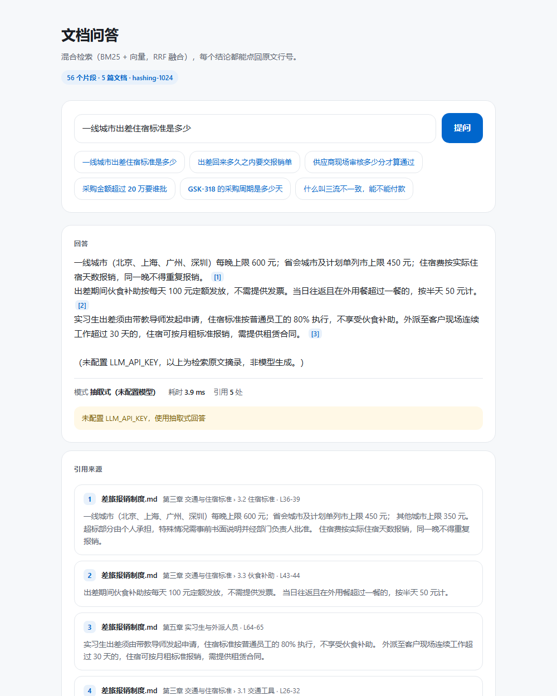

# 文档 RAG 问答服务

> 把一堆企业内部文档变成"能回答、而且能指回原文第几行"的知识库。
> 混合检索（BM25 + 向量，RRF 融合）+ 引用溯源，**核心检索链路零第三方依赖**。



## 这是什么

给一个目录，它会：

1. 读入 `.md` / `.txt` / `.csv` 文档；
2. 按标题层级切块，每块保留「标题路径 + 原文行号」；
3. 建两套索引——BM25 词法索引和向量索引；
4. 提问时两路各自排序，用 RRF 融合，并乘上问题词覆盖度；
5. 把命中的片段连同编号交给大模型，强制它只依据材料作答并标注 `[1] [2]`。

没配置大模型也能用：退化成"检索原文摘录 + 引用"，链路照样跑通。

## 为什么不是一个"调 API 聊天"的 demo

搭一个 `把文档塞进 prompt` 的问答只要二十行代码。真正难的是后面这些：

- **检索不准，模型再强也白搭**。所以这里有 BM25、有向量、有融合、有相关性门槛，
  还有一套固定问题集用来量化"改完之后到底好了还是坏了"。
- **不能溯源，答案就没有信任价值**。所以每个片段都记着来源文件和行号区间。
- **不能拒答，就一定编**。所以有覆盖度门槛：问题里没有一个实词落在片段上时，
  宁可返回"没检索到"，也不硬凑五条垃圾给模型。

## 30 秒跑通

```bash
git clone git@github.com:wjzxly/ai-rag-assistant.git
cd ai-rag-assistant

# 建索引 + 评测，只用标准库
python -m rag.cli ingest
python -m rag.cli eval

# 提问
python -m rag.cli ask "一线城市出差住宿标准是多少"
```

起 Web 服务（需要额外依赖）：

```bash
pip install -e ".[server]"
python -m uvicorn rag.app:app --port 8000
# 打开 http://127.0.0.1:8000
```

## 实测数据

示例语料：5 篇文档（差旅报销、供应商准入、采购付款、发票合规、物料主数据），
共 4946 字，切成 **56 个片段**。

| 指标 | 值 | 说明 |
| --- | --- | --- |
| recall@5 | **100%** | 12 条问题，期望文档全部进入前 5 |
| MRR | **1.000** | 每条问题的期望文档都排在第 1 |
| 关键词命中 | **100%** | 答案片段里包含关键事实（如"600 元""15 个工作日"） |
| 建库耗时 | 约 21 ms | 5 篇文档 / 56 片段 / hashing-1024 |
| 单词问答 | 3–6 ms | 不含大模型调用 |

> 这组数字要谨慎看：语料只有 5 篇、问题只有 12 条，属于**冒烟级基线**，
> 不代表在真实企业知识库上的表现。它的作用是给出一个可对照的起点——
> 换嵌入模型、改分块策略之后，跑同一个 `eval` 就知道有没有真的变好。

复现：

```bash
python -m rag.cli eval -v
```

## 三个关键技术取舍

### 1. 混合检索，而不是只用向量

纯向量在这类文档上会漏招：`GSK-318`、`PO-2026-0912` 这类单据编号和物料编码
是低频精确串，稠密向量对它不敏感，反而是 BM25 的强项；而"报销要什么材料"
↔"差旅费用需要哪些附件"这种字面不重合的问法，又只有向量能救。

两路排序用 **RRF**（`Σ 1/(k+rank)`，k=60）合并。选 RRF 而不是加权求和，
是因为两路分数量纲完全不同（BM25 无上界、余弦在 [-1,1]），归一化要引入额外假设；
RRF 只用名次，天然免疫量纲问题。

**但 RRF 有个真实缺陷**：它只看名次，不看命中强度。实测发现，
一个只碰到"周期"两个字的片段，和一个完整命中「GSK-318 + 采购 + 周期」的片段，
在 RRF 眼里名次只差两位，融合分几乎相同，于是前者靠向量那一路排名靠前就反超了。
修复方式是融合分乘一个覆盖度因子 `0.5 + 0.5 × 覆盖率`——
覆盖率越高说明越对口，同时保留 50% 底分，不把"字面不重合但语义相关"的召回打死。
改完之后 MRR 从 0.944 变成 1.000。

### 2. 拒答是检索层的能力，不是提示词的能力

只靠提示词写"资料不足就说不知道"，模型经常还是会硬答。
这里把判断前移到检索层：问题里的**二元组和英文词**（不统计中文单字）至少要有
15% 出现在片段里，否则不返回该片段。全都被过滤掉时，直接返回"没有检索到相关内容"。

不统计单字是关键——中文单字太容易偶然命中，问"量子计算怎么制备"，
片段里有"材料"就凑上了"材""料"两个字，门槛会形同虚设。

### 3. 默认零依赖，接真模型只需要三个环境变量

默认嵌入后端是纯标准库的 hashing 词袋（签名哈希 + TF-IDF + L2 归一化）。
它不是"能打"的嵌入模型，存在的意义是让 clone 下来的人**不配任何 key 就能跑通全流程**，
并且提供一个可对照的基线。

换成真模型：

```bash
export RAG_EMBEDDER=openai
export EMBEDDING_API_KEY=sk-xxx
export EMBEDDING_BASE_URL=https://api.openai.com/v1   # 任何 OpenAI 兼容服务
export LLM_API_KEY=sk-xxx
export LLM_MODEL=deepseek-chat
export LLM_BASE_URL=https://api.deepseek.com/v1
python -m rag.cli ingest && python -m rag.cli eval
```

配置了 LLM 之后 `ask` 走模型生成；模型接口挂了会自动降级回抽取式，不会整个服务 500。

## 架构

```
文档目录
   │
   ├─ loader      读文件，UTF-8 / GBK 自动识别，跳过 .git 与虚拟环境
   ├─ chunker     按标题切分；CSV 按行切分并转成「列名：值」
   │
   ├─ 词法索引    BM25（k1=1.5, b=0.75）
   └─ 向量索引    hashing（默认，零依赖）或 OpenAI 兼容 API
        │
        ├─ RRF 融合 + 覆盖度加权 + 相关性门槛
        │
        ├─ 检索无结果 → 直接拒答
        └─ 有结果 → LLM 生成（强制引用）/ 抽取式兜底
                        │
                        └─ 答案 + [n] 编号 ↔ 源文件行号
```

## 项目结构

```
rag/
  models.py       Document / Chunk / Hit / Answer
  loader.py       文档读取与编码处理
  chunker.py      分块策略（含 CSV 行级切分）
  text.py         中文分词（单字 + 二元组）
  embedder.py     hashing（零依赖）/ OpenAI 兼容
  index.py        BM25 + 向量 + RRF 融合
  generator.py    LLM 生成与抽取式兜底
  pipeline.py     串流程 + 索引持久化
  evaluation.py   recall@k / MRR / 关键词命中
  cli.py          ingest / search / ask / eval
  app.py          FastAPI 服务
static/index.html 单页前端（原生 JS，无构建链）
examples/docs/    示例语料（虚构公司制度）
examples/qrels.json  12 条评测问题
tests/            33 个测试
```

## 已知局限

写清楚这些，比假装没有要好：

- **默认嵌入不是语义模型**。hashing 词袋只能覆盖字面相近的问法，同义改写会漏。
  要真效果必须接 BGE / text-embedding-3 这类模型。
- **评测集太小**（12 条、5 篇文档），只能证明链路没坏，证明不了泛化能力。
  真实的 RAG 评测需要上百条人工标注问题。
- **索引全量重建**。文档增删会整库重算，没有增量更新，也没有按文档版本做并发快照。
- **没有鉴权与多租户**。定位是单机或内网工具，不适合直接暴露到公网。
- **不支持 PDF / Word**。企业里这两类最多，是下一步最该补的。

## 下一步

- [ ] PDF / docx 解析（`pypdf`、`python-docx`）
- [ ] 增量索引：按 `mtime` 只重建变化的文档
- [ ] BGE 本地嵌入（`sentence-transformers`）作为默认后端
- [ ] 答案级评测：不只是"检索到没有"，还要判"答得对不对"
- [ ] Docker 部署与 GitHub Actions CI

## License

MIT
